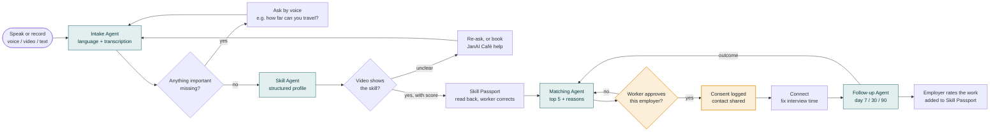
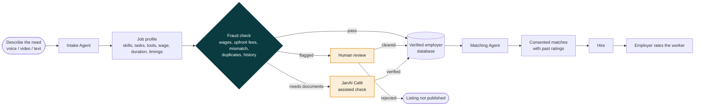
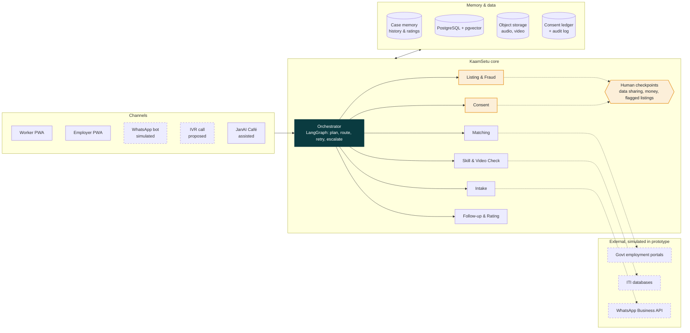

# KaamSetu

**Show your skill. Find work that fits.**

A voice-first, agentic AI platform that connects rural youth with small employers: skills verified from video, every match explained, and nothing shared without consent.

> **Tech4Bharat 2026 · JanAI Mass Entrepreneurship Challenge**
> Problem Statement 8.2 (Theme 8: Youth & Women Empowerment) · Tag: Agentic AI
> **Team Four of a Kind:** Aryan Goyal · Shreshtha Agarwal · Sparsh Agarwal · Dhruv

**Status:** Idea-submission round. This repository holds our design, architecture and pitch deck. Prototype code will be added in `frontend/`, `backend/` and `agents/` as we build it.

📄 **Pitch deck:** [docs/KaamSetu_Pitch_Deck.pdf](docs/KaamSetu_Pitch_Deck.pdf)

---

## The problem

In rural India, jobs still travel through relatives, WhatsApp forwards and placement agents. Hiring depends on *who you know*, not *what you can do*.

- Small employers take **2–3 months** to hire by word of mouth.
- **40–50%** of those hires fail within three months.
- Young workers lose money to **fake listings** and **unpaid wages**.

*(Figures from the Tech4Bharat 2026 problem statement; local figures to be validated in our field study.)*

Both sides want the same thing, a good and lasting match, but have no reliable way to find each other.

## Our solution

KaamSetu has two simple sides, one for **workers** and one for **small employers** (workshops, shops, small factories, farms, contractors). Nobody has to fill a long form or type in English.

### Worker journey

1. **Speak or record:** a voice note, a short video of themselves working, or text, in any language or a mix (Kannada, Hindi, Hinglish…).
2. **Skill Passport:** the agent transcribes, extracts a structured profile, asks short follow-up questions by voice if something is missing, checks the video for evidence of the skill, and reads the passport back so the worker can correct it.
3. **Top 5 matches:** each with a spoken reason (skill, distance, wage, timing).
4. **Consent:** the worker approves each employer before any detail is shared.
5. **Connect:** contact goes only to the approved employer; the agent helps fix an interview time.
6. **Follow-up & rating:** check-ins on day 7, 30 and 90 catch problems like unpaid wages early. The employer rates the work, and the rating joins the worker's Skill Passport for future applications.



### Employer journey

1. **Describe the need** by voice, video (showing the work or machine) or text.
2. **Job profile:** skills, tasks, tools, wage range, duration, timings.
3. **Fraud check before publishing:** unrealistic wages, upfront fees from workers, mismatched details, duplicate or suspicious employers, employer history. Anything needing documents or a visit is routed to a **JanAI Café**.
4. **Verified employer database**, searchable for every new worker.
5. **Matches & rating:** employers see only workers who said yes, with their past-employer ratings, and rate each hire afterwards.



## Why it is agentic, not a chatbot

KaamSetu works on the user's behalf over days and weeks:

| Organisers' criterion | How KaamSetu does it |
|---|---|
| **Plans** multi-step work | A LangGraph orchestrator breaks each case into steps and routes them to agents |
| **Acts** in external systems | WhatsApp, government employment portals, ITI databases *(simulated in prototype)* |
| **Remembers** the case | Persistent case memory per worker and employer; work resumes across days and channels |
| **Recovers** from failure | Bad audio or unclear video → re-ask, or route to a JanAI Café |
| **Asks for approval** | Human checkpoints before sharing personal data, on flagged listings, and before anything involving money |

## Architecture



More detail on each agent: [docs/architecture.md](docs/architecture.md)

## Matching engine

1. **Hard filters:** travel radius, wage range, availability, work type.
2. **Semantic match:** multilingual embeddings, so *"can fix motor winding"* finds *"electrician helper"* across languages.
3. **LLM re-rank:** orders the shortlist by overall fit, learns from day-90 outcomes, and explains each pick.

We match on what makes people **stay** (pay, distance, timing, interest), not just skill.

## Trust, fairness and consent

- Every employer listing is screened **before** any worker sees it.
- A worker's details go to an employer **only with explicit, per-employer consent**, recorded in a consent ledger.
- **Gender, caste and religion are never match features**; results are audited for skew.
- **Minimal data:** only what the match needs.
- **Fair ratings:** only a verified hire can be rated, once; the worker can see and dispute every rating; new workers are shown as new, not as low-rated.
- Every agent action is written to an **audit log**.
- Mock integrations are clearly labelled **simulated**.

## Access and inclusion

- Voice-first and vernacular, with code-mixed speech supported.
- Lightweight **Progressive Web App** for entry-level Android phones; compressed media and background uploads for patchy internet.
- **WhatsApp bot** and **IVR phone line** for users without a smartphone or app.
- **JanAI Café** assisted path for onboarding, document checks and in-person verification.

## Tech stack

| Layer | Choice | Status |
|---|---|---|
| Frontend | React Progressive Web App (worker + employer) | Prototype |
| Messaging | WhatsApp Business bot | Simulated |
| Speech | AI4Bharat IndicConformer / IndicWhisper, or Bhashini / Sarvam APIs; Indic TTS | Comparing options |
| LLM & agents | Gemini / Claude / GPT, or Llama / Qwen; LangGraph orchestration | Prototype |
| Video check | Frame sampling + vision-language model; MediaPipe pose / action checks | VLM in prototype, MediaPipe proposed |
| Matching | BGE-M3 / multilingual-E5 embeddings + pgvector similarity search | Prototype |
| Backend & data | FastAPI (Python), PostgreSQL + pgvector, object storage, Redis queues | Prototype |
| Trust & safety | Consent ledger, audit logs, fraud-rule engine + LLM checks | Prototype |
| Deployment | Docker on cloud | Prototype |

## Business model

- **Workers:** free, always.
- **Small employers:** freemium. A few free listings, then pay per successful hire or a small monthly plan, priced below the cost of a bad hire.
- **ITIs, skilling centres, panchayats, employment schemes (B2G / B2B):** placement infrastructure with placement-rate dashboards.
- **JanAI Café operators:** earn a small fee per assisted onboarding, creating local jobs.

## Roadmap

| Phase | Scope |
|---|---|
| **1. Prototype** (now) | Kannada + Hindi with code-mixing; a few trades (welding, tailoring, wiring, driving); integrations simulated and labelled |
| **2. District pilot** | One ITI + one JanAI Café; measure time to hire, 90-day retention and fraud caught |
| **3. State scale** | More districts via ITIs and panchayats; live scheme integrations; more languages, job categories and IVR |

New languages and trades plug into the same agents without rebuilding the system.

## Repository structure

```
KaamSetu/
├── README.md               ← you are here
├── docs/
│   ├── KaamSetu_Pitch_Deck.pdf
│   └── architecture.md     ← agents, data stores, request walkthrough
├── frontend/               ← React PWA (planned)
├── backend/                ← FastAPI service, database, queues (planned)
└── agents/                 ← LangGraph orchestrator and agents (planned)
```

## References

**Problem and context**
- Ministry of Statistics and Programme Implementation, *Periodic Labour Force Survey (PLFS) Annual Report 2025, press note*: [mospi.gov.in](https://www.mospi.gov.in/uploads/latestReleases/latest_release_1774607827733_3e8964a9-268b-4cc9-ad65-cfc8a9e32f08_Press_note_AR_PLFS_2025_23032025_V2.1_26032026_final.pdf)
- Business Today (July 2026), *More than 9 in 10 job seekers encounter fake job offers* (Indeed survey): [businesstoday.in](https://www.businesstoday.in/jobs/story/more-than-9-in-10-job-seekers-encounter-fake-job-offers-542006-2026-07-09)
- Ministry of Labour & Employment, *National Career Service*: [labour.gov.in/ncs](https://labour.gov.in/ncs)

**Speech in Indian languages**
- Bhogale et al. (2023), *Vistaar: Diverse Benchmarks and Training Sets for Indian Language ASR* (IndicWhisper): [arXiv:2305.15386](https://arxiv.org/abs/2305.15386)
- AI4Bharat, *IndicConformer ASR*: [github.com/AI4Bharat/IndicConformerASR](https://github.com/AI4Bharat/IndicConformerASR)
- Digital India BHASHINI: [bhashini.gov.in](https://bhashini.gov.in)

**Matching**
- Chen et al. (2024), *BGE M3-Embedding*: [arXiv:2402.03216](https://arxiv.org/abs/2402.03216)
- Wang et al. (2024), *Multilingual E5 Text Embeddings*: [arXiv:2402.05672](https://arxiv.org/abs/2402.05672)
- pgvector: [github.com/pgvector/pgvector](https://github.com/pgvector/pgvector)

**Agents and video**
- LangGraph, *Interrupts (human-in-the-loop)*: [docs.langchain.com](https://docs.langchain.com/oss/python/langgraph/interrupts)
- Google MediaPipe, *Pose Landmarker*: [developers.google.com](https://developers.google.com/edge/mediapipe/solutions/vision/pose_landmarker)

---

*Built by Team Four of a Kind for Tech4Bharat 2026.*
